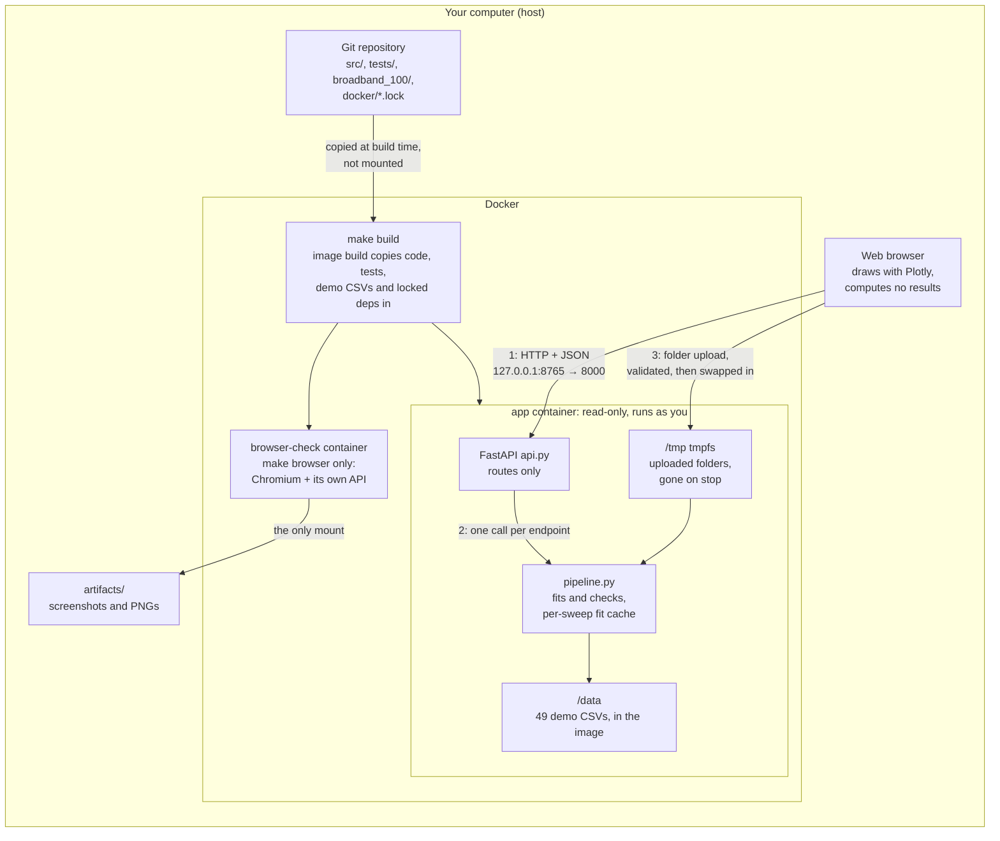

# Architecture

How this project is put together, and why. For a new project this is the
specification to build from; afterwards it is kept true as the project
changes. The rules that apply to every task are in AGENTS.md.

## System at a glance

Everything runs on one computer. Numbered boundaries are described below the
drawing.



1. **Browser ↔ API:** HTTP and JSON typed by `models.py`, published only
   on `127.0.0.1`. The page computes nothing a scientist would call a
   result.
2. **API ↔ science:** `api.py` holds routes only and calls one function in
   `pipeline.py` per endpoint; `pipeline.py` has no web code.
3. **Upload ↔ active data:** `DatasetStore` validates a whole folder in
   `/tmp` before swapping it in under a lock, so a bad upload never replaces
   the active data.

Two consequences follow from the drawing. Code reaches the container only
through a rebuild, so a code change needs `make up`. Uploads live only in
the container's memory-backed `/tmp`, so they vanish on restart.

Known limits of these boundaries:
- Model knowledge still crosses boundary 1 twice: `app.js` repeats the
  starting-field range and the equations. That is the staged geometry task
  in `TASKS.md`.
- There is one active dataset for the whole app, not one per user or tab.
  Two tabs that upload different folders replace each other's data.

## Stack

- Backend: Python 3.14 (base image `python:3.14.0-slim-bookworm`)
  and FastAPI, with typed request and response models; `/docs` is the
  contract.
- Frontend: static HTML and JavaScript, with no build step for our own code.
  Plotly is vendored into the image for the scientific plots; the app page
  uses no browser CDN. The exception is FastAPI's default `/docs` page, whose
  Swagger UI scripts load from jsDelivr in the viewer's browser, so `/docs`
  needs internet access.
- The app runs in one development container, as the host user; browser
  validation uses a separate test container.

## Layout

```text
docker/              everything that builds the development container, and
  Dockerfile
  compose.yaml
  pyproject.toml     Python dependencies, pytest and Ruff configuration
  uv.lock            requires-python = ">=3.14,<3.15"
  package.json       frontend libraries
  package-lock.json
src/app/             the backend: api.py (routes only), pipeline.py, models.py
                     dataset_store.py manages validated, temporary uploads
src/web/             the page: index.html, app.js, styles.css
tests/               pytest
docs/                decisions worth remembering, one short file each
notes/               daily implementation records, named YYYY-MM-DD.md
.github/workflows/   CI: verify.yml runs `make verify` on pull requests and main
.claude/agents/      referee.md, a read-only review subagent
.claude/skills/      review-to-tasks, verify-and-record (project skills)
artifacts/           gitignored browser screenshots and exported plots
.cache/buildx/       gitignored Docker builder metadata kept inside the repo
data/                for future datasets: raw/ is never modified,
                     processed/ is gitignored
broadband_100/       supplied read-only lock-in CSV measurements
Makefile  README.md  ARCHITECTURE.md  AGENTS.md  CLAUDE.md
.gitignore .dockerignore .env.example
```

## Backend

- One pipeline per API endpoint, each with one entry-point function in
  `pipeline.py`. The API calls it; tests may call any function.
- `api.py` holds routes only. It also serves our page from `src/web/` and the
  frontend libraries under `/vendor/`.
- `dataset_store.py` stages CSV uploads under the container's `/tmp`, validates
  every CSV and fit setting before activating it, and serializes reads against
  replacement. Geometry and fit initialization are activated atomically with
  the files and retained for later API calls and page reloads. Uploads are
  limited to 100 MB and 1000 files. These limits are checked while copying
  files Starlette has already received, so an oversized request uses memory
  (the `/tmp` tmpfs) before it is rejected. That is accepted because the app
  listens only on 127.0.0.1.
- Upload validation uses `validate_dataset`: frequency metadata must be positive
  and finite, with at least eight finite numeric field/signal rows per CSV.
  Resonance extraction and aggregate fit success do not gate activation.
- `pipeline.py` owns CSV parsing, resonance extraction, and both scientific
  fits. The frontend receives complete data and fit curves from the API.
  `summarize_analysis` turns the finished result into the `summary`
  sentences, so every judgement on the page comes from the backend.
- Analysis accepts request-scoped `excluded_measurement_ids`, validated for
  length, uniqueness and membership in the active dataset. Both aggregate
  fits use the same included subset; damping uses its refitted g factor.
  Responses retain every resonance point with an `excluded` flag and report
  `included_measurement_count`. Failed per-sweep extractions retain their IDs
  and `extraction_error`, with null extracted values. They must be explicitly
  excluded before fitting the remaining measurements.
- A valid analysis returns all measurements even when scientific fitting is
  unavailable: both aggregate fits are null and `fit_error` explains why.
  This includes fewer than four included sweeps and zero or negative fitted
  resonances that the selected model cannot use. The linewidth fit runs
  after, and separately from, the Kittel fit: if only it fails (for example,
  a negative slope), `kittel_fit` is kept and `linewidth_fit_error` explains
  why.
- Fits report 1σ standard errors: Kittel errors from the `curve_fit`
  covariance, linewidth errors from ordinary least squares, and the damping
  error from slope and g errors in quadrature. `at_bound` names Kittel
  parameters at a fit bound. Damping is `damping_resolved: false` when the
  slope is within 2σ of zero, and `damping_established: false` (reasons in
  `damping_concerns`) when it is unresolved, the linewidth R² is below
  `LINEWIDTH_R_SQUARED_THRESHOLD` (0.5), or ΔH0 + 2σ < 0. `fit_kittel`
  reports the in-plane mirror solution `(−Beff,⊥, B4 + Beff,⊥)` in the
  `mirror_*` fields when its B4 lies inside the B4 fit range.
- The frontend typesets fixed model equations as MathML (the API `equation`
  string is the accessible label) and re-renders charts on a light layout
  for PNG export. Both are presentation only; every number comes from the API.
- Quality checks are computed in `pipeline.py` and returned as flags and a
  `warnings` list: resonance R² below `RESONANCE_R_SQUARED_THRESHOLD` (0.98),
  and peak-to-peak modulation (2√2 × the `OeRMS` value in the filename)
  above ΔHpp/3. Flagged sweeps are never excluded automatically.
  Invalid settings, CSVs, and exclusion IDs remain HTTP 422 errors.
- `analyze_trace` returns raw samples independently of resonance fit success;
  a failed fit has null parameters, an empty curve, and `extraction_error`.
  Signed field coordinates are preserved throughout; no absolute-field
  conversion or implicit branch selection is performed.
- Analysis selects the aligned-axis in-plane Kittel model or the saturated
  perpendicular model `f = (g μB/h)(Bres − Beff,⊥)`, using the convention
  `Beff,⊥ = μ0 Ms − μ0 H2⊥`. Perpendicular defaults are −0.4 T and 10 Oe
  peak-to-peak linewidth; these initialize fits, not fixed results.
  The perpendicular model returns no four-fold term (`null` in the API).

## Browser

- Geometry controls select upload/analysis API settings. Switching to a
  different geometry requires a matching folder; old plots are hidden until
  measurements for that geometry are loaded.
- All scientific points, parameters and curves come from the API.
  JavaScript formats labels, displays equations and handles interaction.
- Clicking markers on either scientific chart or using an accessible dataset
  list selects sweep IDs. Exclude/restore controls request a new analysis;
  selected markers are violet and excluded markers are gray crosses in both
  plots. Orange is always measured data and cyan always a model fit. A failed request leaves the previous results available. Exclusions
  survive refits within the page and reset on reload or a successful upload.
- Valid responses with unavailable fits clear previous property values and
  curves, display an explanatory status, and retain point selection and raw
  inspection. Failed extractions are labeled in the dataset and trace lists;
  their missing coordinates are not plotted. Raw traces still render with an
  unavailable-fit annotation. PNG exports also indicate unavailable fits.
- Backend 1σ errors are formatted as "value ± σ" in cards, captions and PNG
  annotations. Backend warnings are listed above the cards, and flagged
  sweeps are labelled in the dataset list. A damping-only failure keeps the
  Kittel results on screen.
- The results are split across two sections: `#results-summary` (the
  backend `summary` sentences, warnings and cards) comes before the
  controls, and `#results` (exclusions, plots, raw trace) after them. One
  helper shows and hides both.
- Colours are CSS custom properties on `:root`, light by default, with a
  `[data-theme="dark"]` override. The topbar toggle sets `data-theme` and
  stores the choice in `localStorage`. Plot colours are read from the same
  tokens, and the charts redraw on a theme change.
- Plotly charts render after their results section becomes visible, resize
  with `ResizeObserver`, and become one column below 1100 px. Equations,
  legends and axes have reserved margins. PNGs include fitted values and
  an opaque background.

## The container

- The Dockerfile separates build dependencies, app runtime and browser checks:
  one stage with uv only (where `make lock` runs,
  so the first lock needs no lock), one with Node for the frontend libraries,
  and the final app image with both sets of locked dependencies. Compose
  explicitly selects the `app` target. Separate `browser-deps` and
  `browser-runtime`/`browser-checks` stages install the optional Playwright group and
  Chromium with system dependencies at build time. Browser tooling is
  excluded from the normal app image. The profiled `browser` service has no
  published ports, runs as the host user with read-only root and `/tmp`
  tmpfs, and writes artifacts only to the repository's `artifacts/` mount.
- The image contains `src/`, `tests/`, and `docker/pyproject.toml` under
  `/work`, with `PYTHONPATH=/work/src`. Supplied CSVs are copied into the image
  at `/data` as read-only data. Application code and data are read from the
  image because Python received `EDEADLK` reading the macOS bind mount in
  this environment. `.dockerignore` allows only the required build inputs.
  After local code changes, `make up` rebuilds the image and starts the app
  with the updated code.
- Frontend libraries are installed at build time from `package-lock.json` and
  copied into the image. Never installed on the host, never committed, never
  loaded from a CDN.
- The app service publishes on `127.0.0.1` and runs without host bind mounts;
  the Makefile loads `.env` when it exists. The container filesystem is
  read-only except for `/tmp`.
- The bundled dataset is the startup default. Uploaded datasets are held only
  in container `/tmp` (a tmpfs), replace the active dataset after successful
  validation, and are discarded when the container stops. Each sweep's parsed
  data and resonance fit are cached in memory, keyed on the file's path,
  size and modification time and the linewidth seed (at most
  `RESONANCE_CACHE_SIZE` sweeps). Exclude, restore and refit therefore rerun
  only the two property fits. The cache never outlives the process. Plot images are
  exported by Plotly in the browser and are not stored by the backend.

## Makefile

`make help` (the default) lists every target in three groups.

Everyday, the only ones a user needs:

- `build`: build everything the project needs, into the image.
- `up` and `down`: start and stop the app.
- `verify`: check that it all works (lint, test, smoke, browser). Must pass from a
  fresh clone with only Docker, Make and git installed.
- `clean`: return to the state of a fresh clone on a fresh computer. This
  project's containers and both service images (browser profile included)
  are removed, along with `artifacts/`, `.cache/` and the tool caches.
  `data/raw/` and `.env` are kept.

While developing:

- `test`: run the tests copied into the image; `TEST_PATHS` can select test
  files. `lint`: check the code copied into the image, changing nothing.
  Both rebuild first. `fmt`: rewrite the host source and tests into the
  standard format using explicit writable mounts for this command only.
- `smoke`: start the app, require a numeric g factor and damping and
  `"fit_error":null` in a real analysis response, then stop it again.
- `logs` and `shell`: follow the app's output; open a shell inside the
  container.
- `browser`: build the separate browser image and run real Chromium
  upload/refit/reload/export checks against an isolated API inside that
  container. Check page overflow, clipped labels and equation/legend
  overlap at desktop and mobile sizes. Save screenshots and PNGs to
  gitignored `artifacts/`.
- `review`: check Git diff whitespace and display status/statistics.
- `fresh-verify`: clone the committed feature branch into a new directory
  under repository `.cache/` and run `make verify` there. No `.env` or
  uncommitted files are copied. The checkout is kept for inspection.
- `fmt` accepts `FORMAT_PATHS` to limit formatting to selected files.

Only when dependencies change:

- `lock`: after adding, removing or upgrading a package in
  `docker/pyproject.toml` or `docker/package.json`, record the exact versions
  in `docker/uv.lock` and `docker/package-lock.json`, and commit each manifest
  with its lock. `build` uses only what the locks record, and says so, with
  this instruction, when a manifest and its lock disagree.

Container targets run through compose (`docker compose -f docker/compose.yaml`);
`lock` uses build-tool containers directly. Read-only Git review and creating
the artifact directory need no container. The Makefile sets `BUILDX_CONFIG`
to repository-local `.cache/buildx/`, keeping builder activity metadata out
of the host's Docker config folder.
